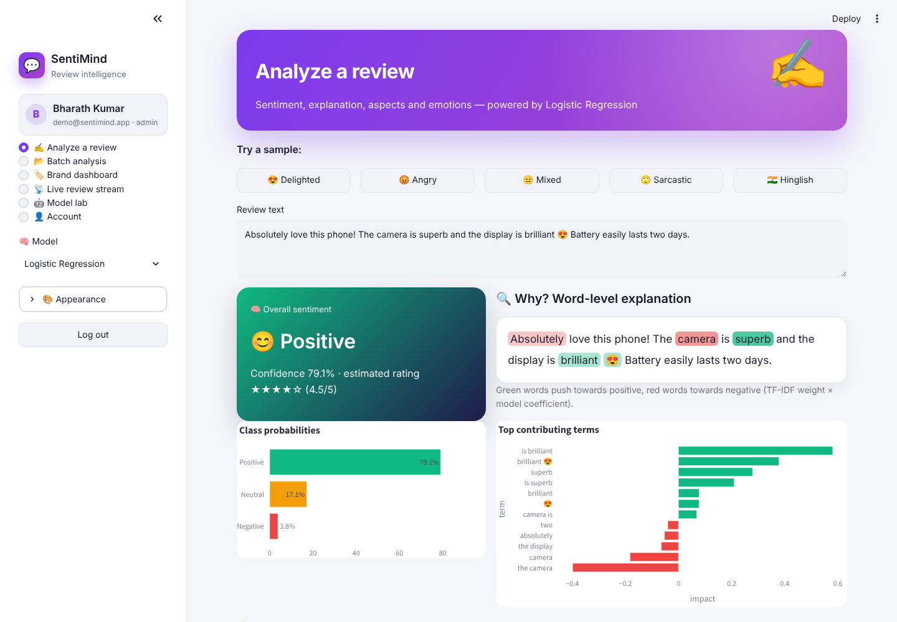
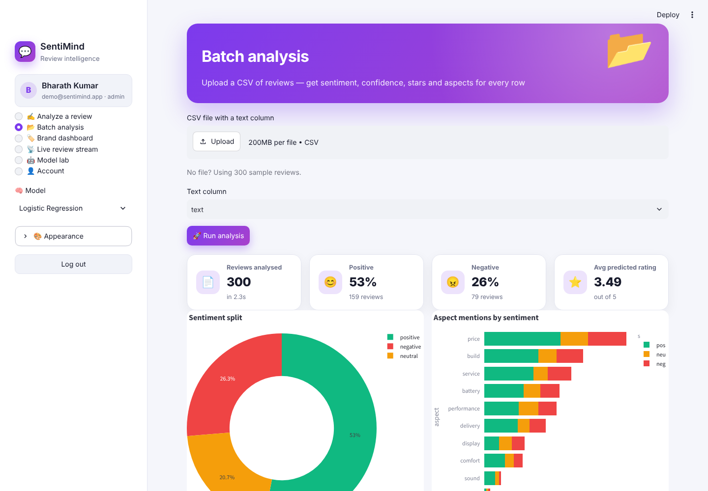
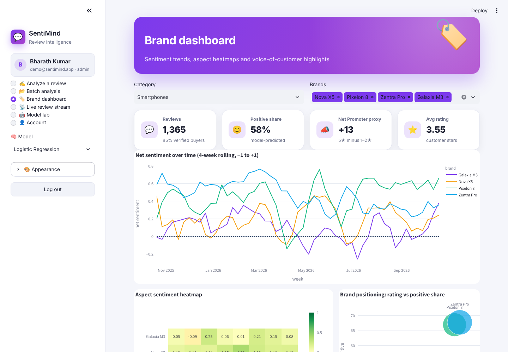
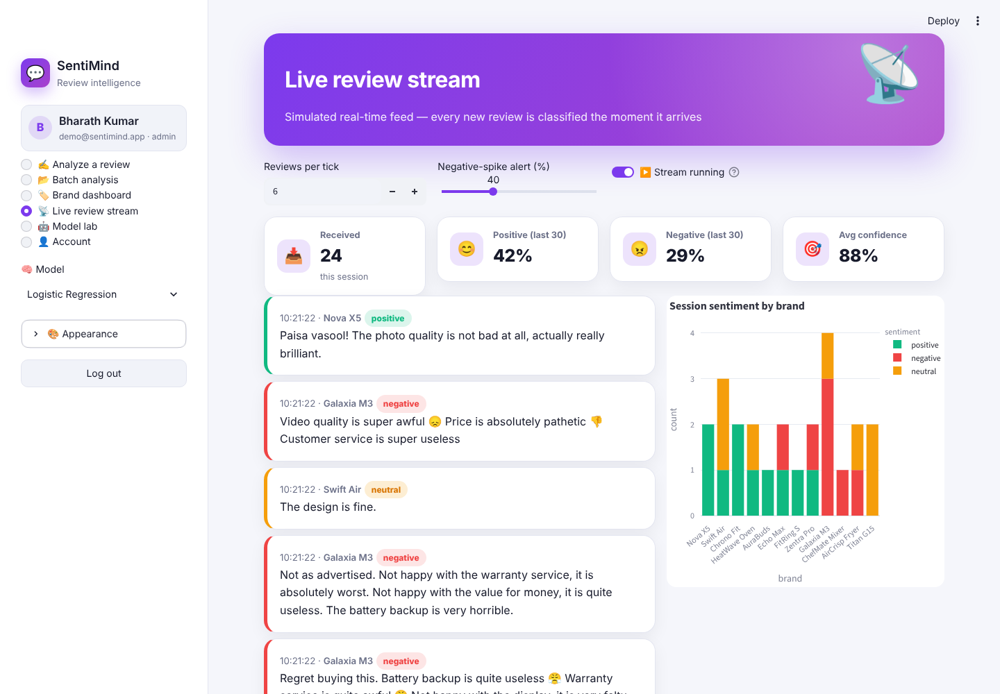
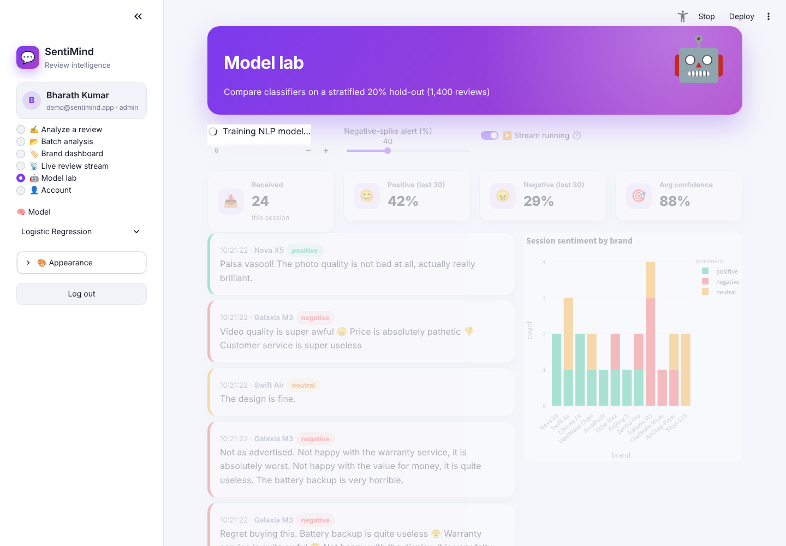
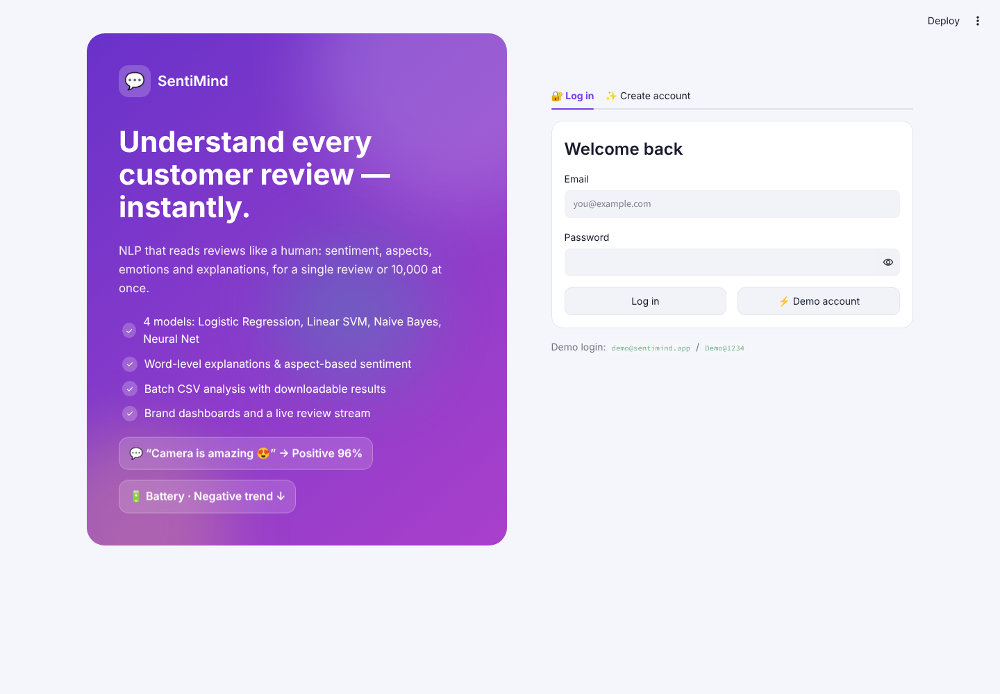

<div align="center">

# 💬 SentiMind — Review Sentiment Intelligence

**NLP that reads product reviews like a human: sentiment, word-level explanations, aspect-based sentiment, emotions, batch CSV analysis, brand dashboards and a live review stream**


</div>

## ✨ Features

| Page | What it does |
|---|---|
| 🔐 **Register / login** | SQLite users with salted **PBKDF2-SHA256** hashes, password-strength meter, roles, demo account, change password |
| ✍️ **Analyze a review** | One-click samples (delighted, angry, mixed, sarcastic, Hinglish), sentiment + confidence + estimated star rating, **inline word highlighting** (green → positive, red → negative), top contributing n-grams, **aspect-based sentiment** per sentence, emotion radar, session history |
| 📂 **Batch analysis** | Upload any CSV, pick the text column, get sentiment / confidence / stars / aspects for every row, sentiment donut, aspect bar chart, filters and CSV download |
| 🏷️ **Brand dashboard** | Weekly net-sentiment trends per brand, brand × aspect heatmap, rating-vs-positivity bubble chart, NPS proxy, most positive & most negative voices |
| 📡 **Live review stream** | Simulated real-time feed classified on arrival, rolling KPIs, configurable **negative-spike alert** |
| 🤖 **Model lab** | Logistic Regression vs calibrated Linear SVM vs Complement Naive Bayes vs **MLP neural network** — accuracy, macro/weighted F1, confusion matrix, per-class report, one-vs-rest ROC/AUC, most predictive n-grams |
| 🎨 **Themes** | Light · Dark · Midnight · Sepia · Forest, 6 accents, animation toggle |

## 🧠 NLP pipeline

```
review ─► word TF-IDF (1–2 grams, emoji-aware tokens)
       ╰► char TF-IDF (3–5 grams: typos, Hinglish, slang)  ─► FeatureUnion ─► classifier ─► negative / neutral / positive
```

* **Corpus** – 7,000 reviews across 5 categories and 20 brands, generated from aspect-level templates with intensifiers, emojis, Hinglish (*paisa vasool, mast, bekar*), sarcasm and 7 % label noise so the task isn't trivially easy.
* **Explanations** – for linear models, each term's contribution = TF-IDF weight × (positive − negative) coefficient.
* **Aspects** – sentences are matched to 10 aspects (battery, display, camera, performance, sound, build, price, delivery, service, comfort) and classified individually.
* **Stars** – `1 + 4 × (P(positive) + 0.5 × P(neutral))`.

## 🖼️ Screenshots

| Analyze a review | Batch analysis |
|---|---|
|  |  |
| **Brand dashboard** | **Live stream** |
|  |  |
| **Model lab** | **Login** |
|  |  |

## 🚀 Run it

```bash
git clone https://github.com/PreciousBharath/SENTIMIND-REVIEW-SENTIMENT-ANALYZER.git
cd SENTIMIND-REVIEW-SENTIMENT-ANALYZER
pip install -r requirements.txt
streamlit run app.py
```

Click **⚡ Demo account** (`demo@sentimind.app` / `Demo@1234`) or register.

## 📁 Project structure

```
app.py      # Streamlit UI — 6 pages
model.py    # corpus generator, TF-IDF pipelines, 4 models, explanations, aspects, emotions
auth.py     # SQLite users + PBKDF2 hashing + login/register UI
theme.py    # 5 themes, accents, animated CSS, Plotly template
ui.py       # hero, KPI and result-card components
```

## 📄 License

MIT © Bharath
